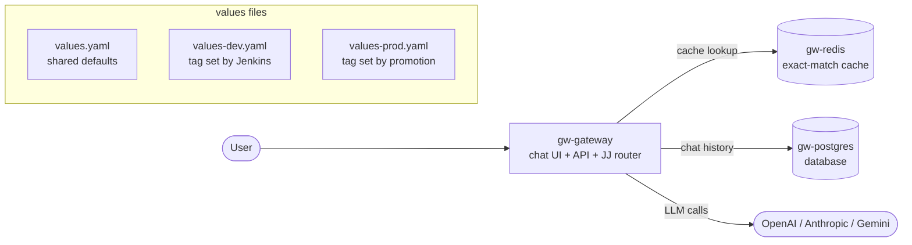
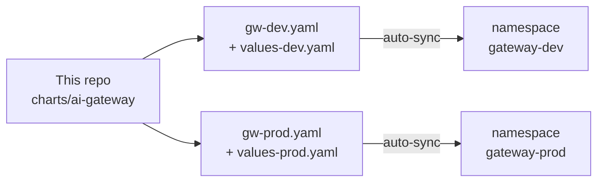
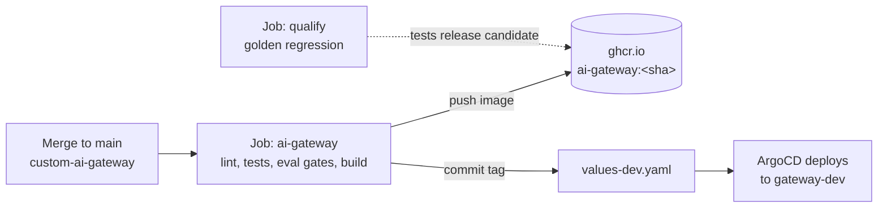

# mlops-router-gitops

This repo holds the **desired state** of the AI gateway: what should run in the cluster, and in which version.
ArgoCD watches it and makes the cluster match. **Nothing is applied by hand.**

Related repos: [product (custom-ai-gateway)](https://github.com/ducthangng/custom-ai-gateway) ·
[platform (mlops-skeleton)](https://github.com/ducthangng/mlops-skeleton)

```
charts/ai-gateway/   WHAT runs      Helm chart: gateway + postgres + redis
argocd/              WHERE it runs  one ArgoCD Application per environment (dev, prod)
jenkins/             HOW it updates CI config: builds images and bumps the dev tag here
```

---

## 1. `charts/ai-gateway/` — what runs

One Helm chart describes the whole product. The same chart is used in every environment; only the values file changes.



| File | Purpose |
|---|---|
| `values.yaml` | Shared defaults (image repo, resources, router and cache settings) |
| `values-dev.yaml` | `image.tag` is bumped by Jenkins on every green build of `main` |
| `values-prod.yaml` | `image.tag` changes only through `make promote` (a reviewed commit) |
| `templates/` | `gateway.yaml`, `postgres.yaml`, `redis.yaml` |

---

## 2. `argocd/` — where it runs

Two ArgoCD Applications, one per environment. Both point at the same chart with a different values file and namespace.



Both apps use **auto-sync + prune + selfHeal**:
- Something removed from Git is removed from the cluster.
- A manual `kubectl` edit is reverted. Make the change here instead.

---

## 3. `jenkins/` — how it updates

Jenkins builds the product and writes the new image tag into this repo. ArgoCD picks it up from there.



| Path | Purpose |
|---|---|
| `jobs/ai-gateway.xml` | Multibranch CI. Every branch is tested; only `main` pushes an image and bumps the tag |
| `jobs/qualify.xml` | Release qualification (contract, routing, cache, load). `SCENARIO=clean\|bad\|partial` |
| `jobs/credential.xml.tpl` | Template for the GitHub credential, synced from a k8s Secret |
| `casc/` | Jenkins Configuration as Code, applied as a ConfigMap and hot-reloaded |
| `values.yaml` | Helm values for a **fresh** Jenkins install only (the running one is never upgraded) |
| `qualify-cache-pvc.yaml` | Volume that caches `qualify` stage results between runs |

---

## Everyday operations

| I want to… | Do this |
|---|---|
| Deploy to dev | Merge to `main` in custom-ai-gateway. Jenkins does the rest. |
| Promote to prod | Run `make promote` in the platform repo, review the commit, push. |
| Roll back | `git revert <commit>` here and push. ArgoCD converges. |
| Change cluster config | Edit it here. Manual cluster changes are reverted. |

**Secrets are never in Git.** `make up` / `make llm-key` in the platform repo create `ghcr-pull`,
`postgres-auth` and `llm-providers` in each `gateway-*` namespace from its `.env`.
